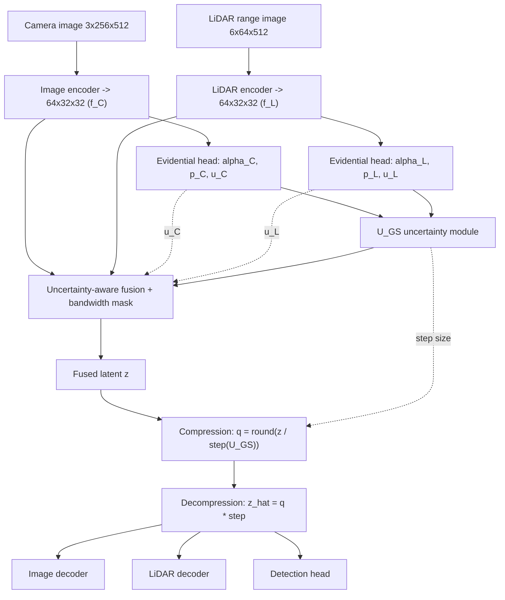

# GeoSem-FSP: Uncertainty-Aware Camera–LiDAR Fusion, Compression and Detection

GeoSem-FSP fuses a **front camera image** and a **front-view LiDAR range image** with an
uncertainty score called **U_GS** (joint geometry–semantic uncertainty). The same score is used to
(1) weight the fusion, (2) decide how strongly the fused feature is compressed before it is sent to a
remote unit, and (3) report how reliable each detected object is.

The code is a single Kaggle notebook trained on **PandaSet**. It reconstructs the image and the LiDAR,
and it detects objects (class, count, distance, direction, reliability).

> **Project status (please read).** This is research code, not a finished product.
> Two parts of the paper abstract are **not implemented yet**: the Dempster–Shafer decision-level
> fusion, and a real entropy coder for the transmitted bits. See [Limitations](#10-limitations-and-future-work).

---

## Table of contents

1. [The idea in one minute](#1-the-idea-in-one-minute)
2. [Background: how LiDAR–camera fusion works](#2-background-how-lidarcamera-fusion-works)
3. [Sensor parameters (camera and LiDAR)](#3-sensor-parameters-camera-and-lidar)
4. [Data pipeline](#4-data-pipeline)
5. [Model architecture](#5-model-architecture)
6. [Loss functions](#6-loss-functions)
7. [Training setup](#7-training-setup)
8. [Evaluation and outputs](#8-evaluation-and-outputs)
9. [Results of the current run](#9-results-of-the-current-run)
10. [Limitations and future work](#10-limitations-and-future-work)
11. [How to run](#11-how-to-run)
12. [References](#12-references)

---

## 1. The idea in one minute

| Sensor | Good at | Weak at |
|---|---|---|
| Camera | Meaning (is it a car or a person?), colour, texture | Exact distance, dark or bright scenes |
| LiDAR | Exact distance and shape | Meaning, sparse far away |

When the two disagree, simple fusion can fail. GeoSem-FSP measures **how sure each sensor is** and
**how much they disagree**, and puts both into one number per image region, **U_GS**.




---

## 2. Background: how LiDAR–camera fusion works

Fusing the two sensors needs three geometric steps (this is the usual recipe, also described in the
[LiDAR–Camera Fusion short guide](https://medium.com/@shashankag14/lidar-camera-fusion-a-short-guide-34115a3055da)):

1. **Camera calibration (intrinsics).** Find the lens parameters that map a 3D point in the camera
   frame to a pixel: focal lengths, principal point, and lens distortion.
2. **LiDAR–camera extrinsic calibration.** Find the rotation and translation between the two sensors,
   so both live in one coordinate frame.
3. **Coordinate alignment and projection.** Move LiDAR points into the camera frame, then project
   them onto the image plane with the camera matrix.

### Where can the data be fused?

| Level | What is fused | Pros | Cons |
|---|---|---|---|
| Early (data) | Raw pixels + raw points | Keeps all information | Needs very exact calibration and sync |
| Feature (middle) | Learned features of each sensor | Network learns what to keep | Needs training data |
| Late (decision) | Final results (boxes, classes) of each sensor | Simple, robust to one sensor failing | Throws away information early |

**GeoSem-FSP is a feature-level fusion** (the fusion block mixes encoder features). The abstract also
plans a decision-level step with Dempster–Shafer theory; that part is future work.

---

## 3. Sensor parameters (camera and LiDAR)

### 3.1 Coordinate frames

| Frame | Axes | Used for |
|---|---|---|
| World | Fixed global frame | PandaSet stores LiDAR points and 3D boxes here |
| Camera | **x right, y down, z forward** (origin at the camera) | All our geometry after alignment |
| Image (pixel) | u to the right, v downward, origin top-left | Where a point appears on the image |

### 3.2 Types of camera parameters

| Group | Parameters | Meaning | Used in this code? |
|---|---|---|---|
| **Intrinsic** | `fx`, `fy` | Focal length in pixels (horizontal, vertical) | Yes |
| | `cx`, `cy` | Principal point (image centre of the optical axis), in pixels | Yes |
| | `s` (skew) | Angle between pixel axes (almost always 0) | No (assumed 0) |
| | image width `W`, height `H` | Native resolution (PandaSet front camera: 1920 x 1080) | Yes (constants `ORIG_W`, `ORIG_H`) |
| **Lens distortion** | `k1, k2, k3` | Radial distortion (straight lines look curved) | **No** (ignored) |
| | `p1, p2` | Tangential distortion (lens not parallel to sensor) | **No** (ignored) |
| **Extrinsic** | `R` (3x3), `t` (3x1) | Camera position and rotation in the world | Yes (from `poses.json`) |
| **Time and capture** | Timestamp, exposure, rolling shutter, trigger offset | Matters when the car moves fast | No |
| **Photometric** | Gain, white balance, gamma | Colour and brightness of the image | No |

The **intrinsic matrix** is

$$
K=\begin{bmatrix} f_x & s & c_x\\ 0 & f_y & c_y\\ 0&0&1\end{bmatrix}
$$

**Field of view** from the intrinsics:

$$
\mathrm{HFOV}=2\arctan\frac{W}{2f_x},\qquad \mathrm{VFOV}=2\arctan\frac{H}{2f_y}
$$

Example: with `fx = fy ≈ 1970` and a 1920 x 1080 image, HFOV ≈ 52.0° and VFOV ≈ 30.7°.
(This is why a fixed ±45° LiDAR sector would **not** match the camera, and why we project with the intrinsics.)

**Lens distortion** (Brown–Conrady model, for normalised coordinates `x = X/Z`, `y = Y/Z`, `r² = x² + y²`):

$$
\begin{aligned}
x_d &= x\,(1+k_1r^2+k_2r^4+k_3r^6) + 2p_1xy + p_2(r^2+2x^2)\\
y_d &= y\,(1+k_1r^2+k_2r^4+k_3r^6) + p_1(r^2+2y^2) + 2p_2xy
\end{aligned}
$$

### 3.3 Extrinsic parameters (pose)

PandaSet gives each camera pose in `poses.json` as a **position** `(x, y, z)` and a **heading quaternion**
`(w, x, y, z)`. The quaternion becomes a rotation matrix:

$$
R=\begin{bmatrix}
1-2(y^2+z^2) & 2(xy-zw) & 2(xz+yw)\\
2(xy+zw) & 1-2(x^2+z^2) & 2(yz-xw)\\
2(xz-yw) & 2(yz+xw) & 1-2(x^2+y^2)
\end{bmatrix}
$$

The 4x4 pose (camera → world) and its inverse (world → camera) are

$$
M=\begin{bmatrix}R & t\\ 0 & 1\end{bmatrix},\qquad
p_{cam}=M^{-1}\,p_{world}
$$

(Code: `quat_to_rot()`, `pose_to_world2cam()`.)

### 3.4 Projecting a LiDAR point onto the image

For a point `p_cam = (X, Y, Z)` in the camera frame (with `Z > 0`), the **pinhole model** gives the pixel:

$$
u=f_x\frac{X}{Z}+c_x,\qquad v=f_y\frac{Y}{Z}+c_y
$$

Or in one matrix step from world coordinates: $s\,[u,v,1]^\top = K\,[R\,|\,t]\,[X_w,Y_w,Z_w,1]^\top$.
A point is kept only if `0 ≤ u < 1920` and `0 ≤ v < 1080` (it must be inside the camera view).

### 3.5 LiDAR parameters

| Item | Value / meaning |
|---|---|
| Point fields (PandaSet) | `x, y, z` (world), `i` (intensity, 0–255), `t` (time), `d` (sensor id) |
| Sensor id `d` | `0` = 64-beam mechanical 360° LiDAR (**used here**), `1` = front-facing LiDAR |
| Range | `r = sqrt(X² + Y² + Z²)` in the camera frame; we keep `1 m < r < 80 m` |
| Azimuth / elevation | `atan2(X, Z)` and `atan2(-Y, sqrt(X²+Z²))` (not used for gridding any more) |

**LiDAR range image used by the network (6 x 64 x 512)**

| Channel | Content | Normalisation |
|---|---|---|
| 0 | Range `r` | `r / 80` |
| 1 | `X` (right) | `X / 40`, clipped to [-1, 1] |
| 2 | `Y` (down) | `Y / 10`, clipped to [-1, 1] |
| 3 | `Z` (forward) | `Z / 80` |
| 4 | Intensity | `i / 255` |
| 5 | Valid mask (1 if a point fell into the pixel) | 0 or 1 |

---

## 4. Data pipeline


### 4.1 Camera branch

1. Load the 1920 x 1080 image.
2. **Resize to 512 x 256** (width x height). Pixels move as `u' = u·512/1920`, `v' = v·256/1080`.
3. Scale pixel values to `[0, 1]`. Result: tensor `3 x 256 x 512`.

### 4.2 LiDAR branch (uses the pose and `intrinsics.json`)

1. Load the point cloud (world frame), keep sensor `d = 0`.
2. **Extrinsics:** `p_cam = M⁻¹ p_world` (Section 3.3).
3. **Intrinsics:** project to pixels `(u, v)` (Section 3.4). Drop points outside the image.
4. **Grid mapping** to the 64 x 512 range image:

$$
\mathrm{col}=\left\lfloor \frac{u}{1920}\cdot 512\right\rfloor,\qquad
\mathrm{row}=\left\lfloor \frac{v}{1080}\cdot 64\right\rfloor
$$

5. If several points fall into one pixel, the **nearest** point wins.

Because `col` uses the same 512 columns as the resized image, **camera and LiDAR are pixel-aligned**:
one cell of the 32 x 32 latent covers the same image region in both encoders.

### 4.3 Detection labels (from PandaSet 3D boxes)

Each 3D box centre is moved to the camera frame and projected with the same equations. The cell on the
**64 x 128** detection grid is

$$
c_x=\left\lfloor \frac{u}{1920}\cdot128\right\rfloor,\qquad c_y=\left\lfloor \frac{v}{1080}\cdot 64\right\rfloor
$$

The class heatmap gets a Gaussian around the centre (radius 3 cells, `σ = 1.5`), with exactly `1.0` at the centre:

$$
H_c(x,y)=\exp\!\left(-\frac{(x-c_x)^2+(y-c_y)^2}{2\sigma^2}\right)
$$

Regression targets at the centre cell: `[X/40, Y/10, Z/80, distance/80]`. If two objects share a cell, the nearer wins.

| Detection class | PandaSet labels (examples) |
|---|---|
| Car | Car, Pickup Truck, Van, other vehicles |
| Truck | Truck, Medium-sized Truck, Semi-truck |
| Bus | Bus, Tram, Train |
| Pedestrian | Pedestrian, Pedestrian with Object |
| TwoWheeler | Bicycle, Motorcycle |
| Obstacle | Cones, Pylons, Barriers, Signs, Containers, Animals |

### 4.4 Split

The data is split **by scene** (no frames of the same scene in two sets), 80 / 10 / 10.
In the current run: **39 scenes → 31 train / 4 val / 4 test = 2480 / 320 / 320 frames**.

---

## 5. Model architecture

### 5.1 Tensor shapes

| Stage | Camera | LiDAR |
|---|---|---|
| Input | 3 x 256 x 512 | 6 x 64 x 512 |
| Encoder strides | (2,2) (2,2) (2,2) (1,2) | (1,2) (1,2) (2,2) (1,2) |
| Features | 64 x 32 x 32 (`f_C`) | 64 x 32 x 32 (`f_L`) |
| Evidential head | `α_C, p_C, u_C` (8 classes) | `α_L, p_L, u_L` (8 classes) |
| Fusion output | 64 x 32 x 32 (`z`) | |
| After compression | `ẑ` (64 x 32 x 32) | |
| Decoder scales | (1,2) (2,2) (2,2) (2,2) → 3 x 256 x 512 | (1,2) (2,2) (1,2) (1,2) → 2 x 64 x 512 |
| Detection head | 6 x 64 x 128 heatmap + 4 x 64 x 128 regression | |

The model has about **6.56 million** parameters.

### 5.2 Building blocks

**Conv block:** $y=\mathrm{ReLU}(\mathrm{BN}(\mathrm{Conv}_{3\times3}(x)))$

**Residual block:** $y=\mathrm{ReLU}\big(x+F(x)\big)$, where $F$ is Conv–BN–ReLU–Conv–BN.

**Encoder:** 4 stages, each = (strided Conv block) + (Residual block). Channels: 64 → 128 → 128 → 64.

**Decoder (PixelShuffle / sub-pixel convolution):** each stage predicts `rh·rw` times more channels
with a 3x3 conv, then rearranges channels into pixels (`rh`, `rw` can differ for height and width):

$$
\mathrm{PS}(X)_{c,\;h\,r_h+i,\;w\,r_w+j}=X_{\,c\,r_hr_w+i\,r_w+j,\;h,\;w}
$$

`PixelShuffle2d` is the exact inverse of `PixelUnshuffle2d`. The conv before the shuffle uses ICNR
initialisation (starts like nearest-neighbour upsampling, which avoids checkerboard patterns).

### 5.3 Evidential head (uncertainty of each sensor)

For each cell and each of `K = 8` classes the network outputs "evidence" `e_k ≥ 0`:

$$
\alpha_k=\mathrm{softplus}(\ell_k)+1,\qquad S=\sum_{k=1}^{K}\alpha_k,\qquad
p_k=\frac{\alpha_k}{S},\qquad u=\frac{K}{S}
$$

Little evidence → `S ≈ K` → `u ≈ 1` (unsure). Much evidence → large `S` → `u` small (sure).
This is the Dirichlet / subjective-logic view of uncertainty.

### 5.4 U_GS: joint geometry–semantic uncertainty

Let `a = 1 − p_C[empty]` and `b = 1 − p_L[empty]` be "something is here" from camera and LiDAR.

$$
\mathrm{IoU}=\frac{ab}{a+b-ab},\qquad
D_{JS}(p_C\,\Vert\,p_L)=\frac{1}{\ln 2}\Big[\tfrac12 \mathrm{KL}(p_C\Vert m)+\tfrac12\mathrm{KL}(p_L\Vert m)\Big],\; m=\tfrac{p_C+p_L}{2}
$$

$$
\boxed{U_{GS}=\sigma\big(w_1(1-\mathrm{IoU})+w_2\,D_{JS}(p_C\Vert p_L)+w_3\,u_C+w_4\,u_L+b\big)}
$$

* `1 − IoU` = **geometric disagreement**, `D_JS` = **semantic conflict** (value in `[0, 1]`).
* `w1…w4` and `b` are **learned** (start: `w = 1`, `b = −1.5`).
* The inputs are **detached**, so U_GS does not change how the evidential heads learn.

### 5.5 Uncertainty-aware fusion

Confidence of each sensor and its normalised weight:

$$
a_C=1-u_C,\quad a_L=1-u_L,\quad
\tilde a_C=\frac{2a_C}{a_C+a_L},\quad \tilde a_L=\frac{2a_L}{a_C+a_L}
\quad(\tilde a_C+\tilde a_L=2)
$$

Weighted features are concatenated (128 channels) and mixed by `1x1 Conv + BN + ReLU` and a final `3x3 Conv`
(**linear output**, so `z` can be negative):

$$
f=\mathrm{Mix}\big([\tilde a_C f_C,\;\tilde a_L f_L]\big)
$$

**Bandwidth mask.** U_GS decides how many of the `C = 64` latent channels are kept:

$$
bw=m_{min}+(1-m_{min})\,U_{GS},\qquad
m_c=\sigma\big(12\,(bw-c/C)\big),\qquad z=f\odot m
$$

with `m_min = 0.75` (at least about 75% of the channels stay active).


### 5.6 Compression and decompression


**Compression (vehicle side).** The quantiser step depends on U_GS:

$$
\Delta=\Delta_{min}+(\Delta_{max}-\Delta_{min})(1-U_{GS}),\qquad q=\mathrm{round}\!\left(\frac{z}{\Delta}\right)
$$

with `Δmin = 0.01`, `Δmax = 0.20`. **High U_GS → small Δ → fine detail. Low U_GS → large Δ → heavy compression.**

**Decompression (remote side):**

$$
\hat z=q\,\Delta
$$

During training, rounding has zero gradient, so a **straight-through estimator** is used:
$\hat z = z+\mathrm{stopgrad}(q\Delta-z)$.

**Rate proxy.** The code *estimates* the cost per latent value as

$$
\mathrm{bits}=\log_2\!\left(1+\frac{|z|}{\Delta}\right)
$$

> This is only an estimate. There is **no real bitstream or entropy coder** yet, so do not report it as the final bandwidth.

### 5.7 Inverse of fusion (decoders)

Fusion mixes information, so it has no exact mathematical inverse. Two learned **decoders** rebuild each input from `ẑ`:

* **Image decoder:** `ẑ → 3 x 256 x 512`, sigmoid.
* **LiDAR decoder:** `ẑ → 2 x 64 x 512`: `range = sigmoid(ch0)` and a mask logit `ch1` (anisotropic upsampling).

### 5.8 Detection head

`ẑ` is upsampled to a 64 x 128 map with a PixelShuffle block, the (bilinearly upsampled) U_GS map is
concatenated, then `Conv → ResBlock → Conv` and two `1x1` heads give the **class heatmap** (6 classes)
and the **regression** `[X, Y, Z, distance]`.

**Decoding objects:** a cell is an object if it is the best class at its place, a local maximum in a 3x3
window, and above its class threshold (Car/Truck/Bus 0.35, Pedestrian/TwoWheeler 0.30, Obstacle 0.45).
Reported distance (`dist_m`) is the **LiDAR distance** (25th percentile of the range pixels around the cell)
when available, otherwise the network prediction. Reliability is `1 − U_GS` at that cell.

---

## 6. Loss functions

The training objective follows the paper abstract, plus one auxiliary reconstruction term:

$$
\boxed{\mathcal L=L_{det}+\lambda_1L_{feat}+\lambda_2L_{geo\text{-}sem}+\lambda_3L_{comp}+\lambda_{rec}L_{rec}}
$$

| Symbol | Value | Meaning |
|---|---|---|
| `λ1` (`LAM_FEAT`) | 0.5 | feature consistency |
| `λ2` (`LAM_GEOSEM`) | 0.5 | geometry–semantic agreement |
| `λ3` (`LAM_COMP`) | 0.5 | compression |
| `λ_rec` (`LAM_REC`) | 1.0 | image + LiDAR reconstruction |

### 6.1 Detection loss `L_det`

Focal loss on the heatmap (CenterNet style, `p` = predicted, `g` = Gaussian target, `N_pos` = number of centres) plus L1 on the regression:

$$
L_{focal}=-\frac{1}{N_{pos}}\Big[\sum_{g=1}(1-p)^2\log p+\sum_{g<1}(1-g)^4\,p^2\log(1-p)\Big],\qquad
L_{det}=L_{focal}+5\cdot L_1(\mathrm{reg})
$$

### 6.2 Feature consistency `L_feat`

Camera and LiDAR features should be similar where the two sensors agree (low U_GS):

$$
L_{feat}=\frac{\sum (1-U_{GS})\,\big(1-\cos(f_C,f_L)\big)}{\sum (1-U_{GS})}
$$

### 6.3 Geometry–semantic loss `L_geo-sem`

Evidential loss for both heads (Sensoy et al.) with pseudo-labels `y` (one-hot), plus an agreement term:

$$
L_{evid}=\sum_k (y_k-p_k)^2+\sum_k\frac{p_k(1-p_k)}{S+1}+\lambda_{KL}\,\mathrm{KL}\big(\mathrm{Dir}(\tilde\alpha)\,\Vert\,\mathrm{Dir}(\mathbf 1)\big),\quad
\tilde\alpha=y+(1-y)\odot\alpha
$$

$$
L_{agree}=\overline{(1-\mathrm{IoU})}+\overline{D_{JS}},\qquad
L_{geo\text{-}sem}=L_{evid}^{C}+L_{evid}^{L}+0.5\,L_{agree}
$$

* `λ_KL` grows linearly from 0 to `KL_MAX = 0.05` during the first half of training.
* **Pseudo-labels** (PandaSet semantic labels are not used): class 0 = "empty" (occupancy < 5% in the cell);
  classes 1–7 are range bins of the mean LiDAR range in the cell: `< 6.4`, `6.4–12`, `12–20`, `20–28`, `28–40`, `40–56`, `> 56` metres.

### 6.4 Compression loss `L_comp`

$$
L_{comp}=\overline{(0.5+U_{GS})\,(z-\hat z)^2}+0.01\cdot\overline{\log_2\!\Big(1+\frac{|z|}{\Delta}\Big)}
$$

The first term pulls `z` onto its quantisation grid (errors in uncertain regions cost more); the second term
pushes toward fewer bits.

### 6.5 Reconstruction loss `L_rec`

**Image:** L1 + structure + edge loss

$$
L_{img}=\overline{|\hat x-x|}+\big(1-\mathrm{SSIM}(\hat x,x)\big)+1.0\cdot\Big(\overline{|\nabla_x\hat x-\nabla_x x|}+\overline{|\nabla_y\hat x-\nabla_y x|}\Big)
$$

$$
\mathrm{SSIM}=\frac{(2\mu_x\mu_y+C_1)(2\sigma_{xy}+C_2)}{(\mu_x^2+\mu_y^2+C_1)(\sigma_x^2+\sigma_y^2+C_2)}\quad(7\times7\text{ window})
$$

**LiDAR:** masked L1 on range + masked edge loss + BCE + Dice for the mask (`m` = valid mask, `p` = predicted mask probability):

$$
L_{lid}=\frac{\sum m\,|\hat r-r|}{\sum m}+0.5\,(G_x+G_y)+\mathrm{BCE}(p,m)+\Big[1-\frac{2\sum pm+1}{\sum p+\sum m+1}\Big]
$$

`G_x, G_y` are masked L1 errors of the horizontal and vertical range gradients (only where both neighbours are valid).
Dice helps because only a small part of the pixels is valid.

---

## 7. Training setup

| Item | Value |
|---|---|
| Dataset | PandaSet (front camera, LiDAR sensor 0, 3D cuboids) |
| Split | 80 / 10 / 10 by scene, seed 42 |
| Input size | image 256 x 512, range image 64 x 512 |
| Optimiser | AdamW, learning rate `1e-3`, weight decay `1e-4` |
| Schedule | OneCycle (max LR `1e-3`) |
| Batch size | 16 |
| Gradient clipping | 5.0 |
| Epochs | 50 in the reported run (`EPOCHS` constant; 5 for a quick test) |
| Model selection | lowest **total validation loss** is saved as the best checkpoint |
| Hardware used | one Kaggle GPU, about 235 s per epoch |

A **smoke test** cell runs the whole model, loss and backward pass on random data before training to catch shape errors.

---

## 8. Evaluation and outputs

| Metric | Definition |
|---|---|
| Image PSNR | $10\log_{10}(1/\mathrm{MSE})$ (images in `[0, 1]`) |
| LiDAR range MAE | Mean absolute range error (metres) on valid pixels |
| Object distance MAE | Mean absolute difference between predicted and labelled distance at labelled object centres (metres) |
| Est. bits / element | Rate proxy from Section 5.6 (float32 would be 32) |
| U_GS mean / std | Printed every epoch; a std near 0 means U_GS is not adapting |

**Notebook sections**

| Section | Output |
|---|---|
| 5. Show results | Input vs reconstructed image, input vs reconstructed LiDAR range, U_GS map, top-view point cloud |
| 6. Scene report | Per frame: detected objects and counts vs ground truth; table with class, confidence, distance (final / predicted / LiDAR), lateral offset, direction, reliability; nearest LiDAR return in left / centre / right corridor |
| 7. YOLO + LiDAR | Pretrained YOLOv8 finds *what* an object is on the full image; LiDAR points inside the box give *how far*; compared with the detection head |

**YOLO + LiDAR distance.** Project all LiDAR points to the image, keep points in the central 60% of the box,
sort by distance, keep the **nearer half** (to ignore the background) and use the median. YOLO needs Internet
the first time (to install `ultralytics` and download weights).

Files written to `/kaggle/working`: `geosem_fsp_best.pt`, `loss_curve.png`, `reconstructions.png`,
`lidar_topview.png`, `scene_report_*.png`, `scene_reports.json`, `yolo_lidar_*.png`, `yolo_lidar_reports.json`.

---

## 9. Results of the current run

> One run, 50 epochs, one random split, no repeated seeds. Treat the numbers as a baseline, not a final result.

**Test set (best-validation checkpoint, epoch 8 of this run)**

| Metric | Value |
|---|---|
| Total loss | 3.551 |
| `L_det` / `L_feat` / `L_geo-sem` / `L_comp` | 1.374 / 0.112 / 2.803 / 0.0167 |
| Image PSNR | 22.23 dB |
| LiDAR range MAE | 4.54 m |
| Object distance MAE at labelled centres | 6.04 m |
| Estimated bits per latent element | ≈ 1.57 (proxy) |

**What the training log shows**

* Validation total loss is lowest at **epoch 8** (3.79) and then rises, while the training loss keeps falling (5.75 → 0.60).
* The rise comes mostly from **`L_det` on the validation set** (about 1.5 at epoch 8 → 4.4 at epoch 50): the detector **overfits** (only 31 training scenes).
* At the same time reconstruction keeps improving: validation PSNR reaches about **25.8 dB** and range MAE about **2.0 m** at epoch 50.
* Because the checkpoint is chosen by the *total* validation loss, the saved model is the epoch-8 one, so the test reconstructions are worse than the final epoch could give.
* U_GS now adapts: its standard deviation grows from 0.018 to about 0.11 (mean 0.47 → 0.60), and object reliability varies between about 0.43 and 0.65 instead of being constant.

**Scene reports (3 test frames)**

* Cars and buses are found fairly well; **pedestrians are under-detected** (for example 5–7 detected vs 17–38 labelled), and two-wheelers and obstacles were missed in these frames.
* The distance **predicted by the network** can be far off for distant objects (for example 65 m predicted vs 27 m measured). The reported `dist(final)` uses the LiDAR measurement, which is much closer to the truth.

---

## 10. Limitations and future work

| Topic | Status |
|---|---|
| Dempster–Shafer decision-level fusion (paper abstract) | **Not implemented** |
| Real compression | Only quantisation + a bit **estimate**; no entropy coder, no real bitstream |
| Evidential labels | Pseudo-classes from LiDAR range, not real semantic labels |
| Lens distortion | Ignored (only `fx, fy, cx, cy` and the pose are used) |
| Distance in the report | Final distance uses raw LiDAR on the vehicle side; the compressed latent alone gives a weaker distance |
| Detection overfitting | Small training set (31 scenes); consider augmentation, early stopping on `L_det`, or choosing the checkpoint by a reconstruction metric |
| Checkpoint choice | Total validation loss picks an early epoch; track separate best checkpoints for reconstruction and detection |
| Statistics | Single run; repeat with several seeds and report mean and standard deviation |
| Reconstruction sharpness | Limited by the 64 x 32 x 32 latent (about 6x fewer values than the image); a larger `LATENT_C` or a perceptual loss may help, at a cost in bits |

---

## 11. How to run

1. Create a Kaggle notebook with a **GPU**, and add the **PandaSet** dataset
   (`usharengaraju/pandaset-dataset`). Turn **Internet ON** only if you want the YOLO section.
2. Upload `geosem-fsp-pandaset-v3.ipynb` (or paste `geosem_fsp_pandaset_v3.py` into one cell).
3. Check `DATA_ROOT` in the config cell (default: `/kaggle/input/datasets/usharengaraju/pandaset-dataset`).
4. Run all cells. The smoke test runs first; then training, test, reconstructions, scene report and YOLO.

Main settings (config cell):

```python
EPOCHS = 50            # use 5 for a quick test
BATCH_SIZE = 16
LATENT_C = 64          # latent channels
DET_H, DET_W = 64, 128 # detection grid
LAM_FEAT, LAM_GEOSEM, LAM_COMP, LAM_REC = 0.5, 0.5, 0.5, 1.0
Q_MIN, Q_MAX = 0.01, 0.20   # quantiser step range
MASK_MIN = 0.75        # minimum fraction of channels kept by the bandwidth mask
KL_MAX = 0.05          # final weight of the evidential KL term
```

Suggested repository layout:

```
.
├── README.md
├── geosem-fsp-pandaset-v3.ipynb
├── geosem_fsp_pandaset_v3.py
└── docs/
    └── figures/
        ├── fig1_overall_architecture.png
        ├── fig2_fusion_internals.png
        ├── fig3_compression_decompression.png
        └── fig4_preprocessing_calibration.png
```

---

## 12. References

* LiDAR–Camera Fusion: a short guide (Medium): <https://medium.com/@shashankag14/lidar-camera-fusion-a-short-guide-34115a3055da>
* Y. Cui et al., *Deep Learning for Image and Point Cloud Fusion in Autonomous Driving: A Review*, arXiv:2004.05224.
* T. Liang et al., *BEVFusion: A Simple and Robust LiDAR-Camera Fusion Framework*, arXiv:2205.13790.
* P. Xiao et al., *PandaSet: Advanced Sensor Suite Dataset for Autonomous Driving*, ITSC 2021.
* M. Sensoy, L. Kaplan, M. Kandemir, *Evidential Deep Learning to Quantify Classification Uncertainty*, NeurIPS 2018.
* A. Jøsang, *Subjective Logic*, Springer, 2016.
* G. Shafer, *A Mathematical Theory of Evidence*, Princeton University Press, 1976.
* X. Zhou, D. Wang, P. Krähenbühl, *Objects as Points* (CenterNet), arXiv:1904.07850.
* T.-Y. Lin et al., *Focal Loss for Dense Object Detection*, ICCV 2017.
* W. Shi et al., *Real-Time Single Image and Video Super-Resolution Using an Efficient Sub-Pixel Convolutional Neural Network*, CVPR 2016.
* A. Aitken et al., *Checkerboard artifact free sub-pixel convolution*, arXiv:1707.02937.
* Z. Wang et al., *Image Quality Assessment: From Error Visibility to Structural Similarity*, IEEE TIP 2004.
* Ultralytics YOLOv8: <https://github.com/ultralytics/ultralytics>

> Please check the reference list against the original papers before you cite it in a publication.
